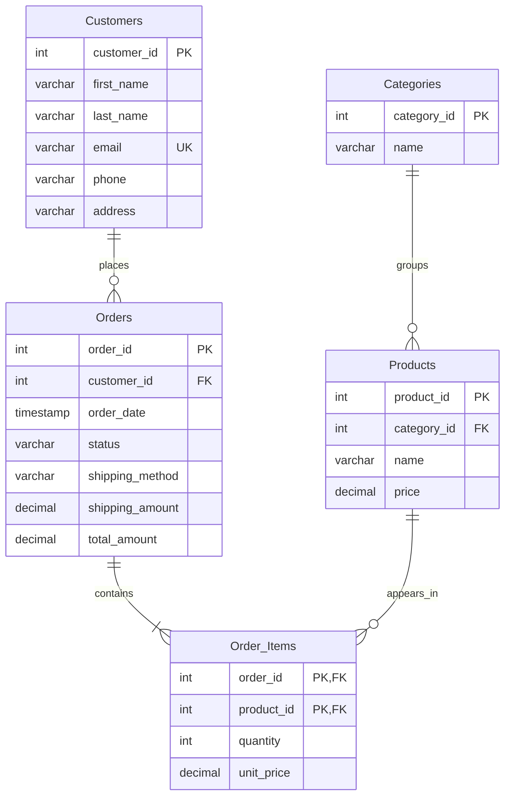

# BrandY store ERD



## SQL table definitions

```sql
CREATE TABLE Customers (
    customer_id INT UNSIGNED AUTO_INCREMENT PRIMARY KEY,
    first_name VARCHAR(80) NOT NULL,
    last_name VARCHAR(80) NOT NULL,
    email VARCHAR(255) NOT NULL UNIQUE,
    phone VARCHAR(30) NOT NULL,
    address VARCHAR(255) NOT NULL
);

CREATE TABLE Categories (
    category_id INT UNSIGNED AUTO_INCREMENT PRIMARY KEY,
    name VARCHAR(100) NOT NULL UNIQUE
);

CREATE TABLE Products (
    product_id INT UNSIGNED AUTO_INCREMENT PRIMARY KEY,
    category_id INT UNSIGNED NOT NULL,
    name VARCHAR(120) NOT NULL,
    price DECIMAL(10, 2) NOT NULL,
    INDEX products_name_index (name),
    FOREIGN KEY (category_id) REFERENCES Categories(category_id) ON DELETE RESTRICT
);

CREATE TABLE Orders (
    order_id INT UNSIGNED AUTO_INCREMENT PRIMARY KEY,
    customer_id INT UNSIGNED NOT NULL,
    order_date TIMESTAMP NOT NULL DEFAULT CURRENT_TIMESTAMP,
    status VARCHAR(30) NOT NULL DEFAULT 'Pending',
    shipping_method VARCHAR(20) NOT NULL,
    shipping_amount DECIMAL(10, 2) NOT NULL,
    total_amount DECIMAL(10, 2) NOT NULL,
    FOREIGN KEY (customer_id) REFERENCES Customers(customer_id) ON DELETE RESTRICT
);

CREATE TABLE Order_Items (
    order_id INT UNSIGNED NOT NULL,
    product_id INT UNSIGNED NOT NULL,
    quantity INT UNSIGNED NOT NULL,
    unit_price DECIMAL(10, 2) NOT NULL,
    PRIMARY KEY (order_id, product_id),
    FOREIGN KEY (order_id) REFERENCES Orders(order_id) ON DELETE CASCADE,
    FOREIGN KEY (product_id) REFERENCES Products(product_id) ON DELETE RESTRICT
);
```

## Relationship notes

- One customer can place many orders; each order belongs to one customer.
- One category groups many products; each product belongs to one category.
- Each order contains one or more order items. The composite key prevents a product from appearing twice on the same order; quantity records repeated units.
- One product can appear in many order items. `unit_price` preserves the purchase-time price even if the product price later changes.
- `Orders.total_amount` records the final checkout total. `shipping_method` and `shipping_amount` store the chosen delivery option and charge.
- Laravel migrations create these five tables; the catalog seeder adds the three categories and four demo products.
